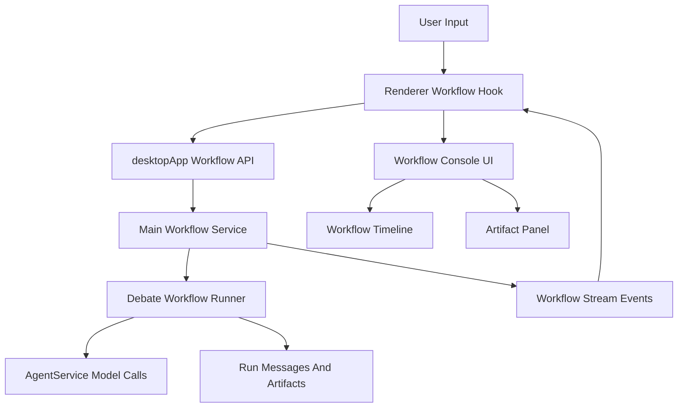
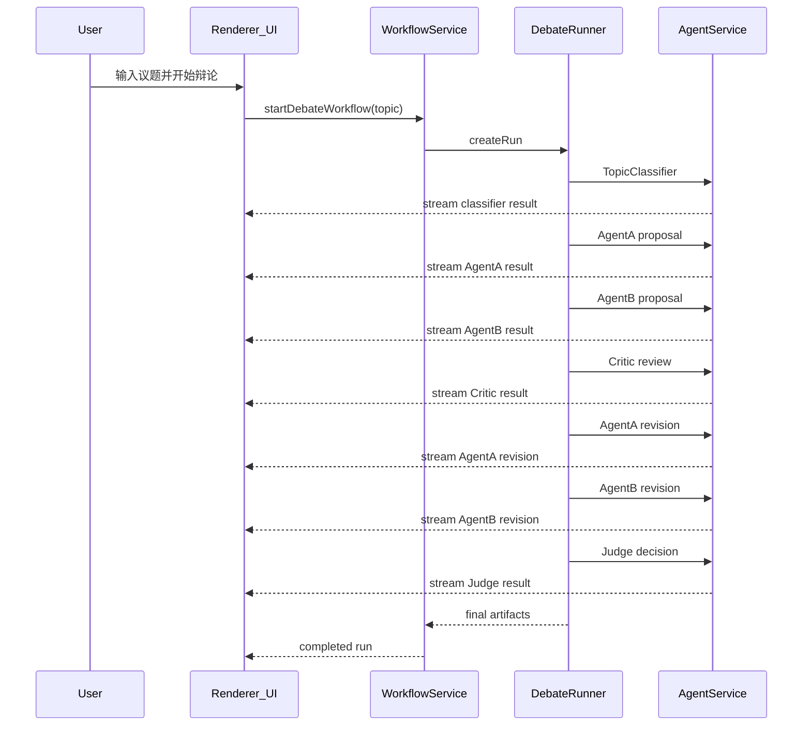

# Debate Workflow 第一阶段详细设计

## 1. 目标

第一阶段目标是在现有桌面端 Agent 控制台架构上实现第一个通用 `workflow`：`debate`，并为后续扩展 `deep_research`、`simulation`、`forecast` 等多 Agent 工作流能力打好基础。

核心目标：

- 在现有 `Sidebar + ConsolePanel + MessageList + Composer` UI 架构上增加 `debate workflow`。
- 抽象可复用的数据模型：`WorkflowRun`、`WorkflowStage`、`WorkflowActor`、`WorkflowArtifact`、`WorkflowStreamEvent`。
- 保持普通聊天能力稳定，`chat` 与 `workflow` 在第一阶段使用独立 API，降低回归风险。
- 第一阶段优先做到可运行、可展示、可扩展，不做复杂工作流模板编辑器和持久化数据库。

## 2. 当前架构依据

当前项目已有一套较清晰的单 Agent 聊天链路：

- 共享消息协议位于 `src/shared/agent.ts`。
- Renderer 通过 `src/renderer/lib/hooks/use-chat-session.ts` 调用 `runAgent()`。
- Renderer 通过 `src/renderer/lib/hooks/use-app-bootstrap.ts` 监听 `agent:stream`。
- 主进程通过 `src/main/agent-service.ts` 维护对话、调用模型并发出 `AgentStreamEvent`。
- 主 UI 容器为 `src/renderer/features/layout/ConsolePanel.tsx`。
- 消息列表为 `src/renderer/features/messages/MessageList.tsx`。

当前架构适合“单 Agent 对话”，但不直接表达多 Agent、多阶段、结构化产物。因此第一阶段需要在保留现有聊天协议的基础上，增加 workflow 元信息和 workflow runtime。

## 3. 总体架构



设计原则：

- `AgentService` 继续作为底层模型调用能力。
- `WorkflowService` 负责 run 生命周期、事件转发和内存存储。
- `DebateRunner` 负责 debate 的固定阶段编排。
- Renderer 新增 workflow 状态 hook，与普通聊天状态隔离。
- UI 上把 `ConsolePanel` 升级为模式容器，支持 `chat` 与 `workflow`。

## 4. 核心概念

### 4.1 Workflow

`Workflow` 表示一种多 Agent 工作流模板，例如：

- `chat`：普通聊天。
- `debate`：通用议题辩论。
- `deep_research`：深度研究。
- `simulation`：沙盘推演。
- `forecast`：预测分析。

第一阶段只实现 `debate`，但类型和 UI 命名均保持通用。

### 4.2 Run

`WorkflowRun` 表示一次具体执行实例。

包含：

- `id`：run 唯一标识。
- `type`：workflow 类型。
- `title`：展示标题。
- `status`：运行状态。
- `currentStageId`：当前阶段。
- `inputs`：用户输入。
- `config`：运行配置。
- `actors`：参与者。
- `stages`：阶段列表。
- `messages`：过程消息。
- `artifacts`：结构化产物。

### 4.3 Stage

`WorkflowStage` 表示 workflow 中的一个阶段。

`debate` 第一阶段包含：

1. `classify`：议题识别。
2. `proposal`：A/B 独立立论。
3. `critique`：Critic 批判。
4. `revision`：A/B 回应修正。
5. `judgement`：Judge 评分裁决。

### 4.4 Actor

`WorkflowActor` 表示参与 workflow 的执行者。

`debate` 第一阶段包含：

- `classifier`：识别议题类型并生成配置。
- `agent_a`：支持或积极推进主张。
- `agent_b`：反对或审慎评估主张。
- `critic`：审查漏洞、反例和风险。
- `judge`：按 rubric 评分并裁决。

### 4.5 Artifact

`WorkflowArtifact` 表示结构化产物，区别于聊天消息。

`debate` 第一阶段包含：

- `debate_config`：辩论配置。
- `proposal_a`：Agent A 初始观点。
- `proposal_b`：Agent B 初始观点。
- `critique`：Critic 批判意见。
- `revision_a`：Agent A 修正观点。
- `revision_b`：Agent B 修正观点。
- `scoring_table`：评分表。
- `final_decision`：最终裁决。

## 5. 共享类型设计

### 5.1 扩展 `AgentMessage`

在 `src/shared/agent.ts` 中给 `AgentMessage` 增加可选字段：

```ts
workflow?: WorkflowMessageMeta;
```

这样普通聊天消息不受影响，workflow 消息可以额外携带多 Agent 元信息。

`WorkflowMessageMeta` 包含：

```ts
workflowId?: string;
runId?: string;
workflowType?: WorkflowType;
stageId?: string;
stepId?: string;
actorId?: string;
actorRole?: string;
phase?: string;
artifactType?: string;
```

### 5.2 扩展 `AgentStreamEvent`

`AgentStreamEvent` 同样增加：

```ts
workflow?: WorkflowMessageMeta;
```

这样流式输出时，Renderer 能识别当前 chunk 属于哪个 run、哪个 actor、哪个 stage。

### 5.3 新增 `workflow.ts`

新增 `src/shared/workflow.ts`，集中定义：

- `WorkflowType`
- `WorkflowRunStatus`
- `WorkflowMessageMeta`
- `WorkflowActor`
- `WorkflowStage`
- `WorkflowArtifact`
- `WorkflowRun`
- `WorkflowStreamEvent`
- `DebateConfig`
- `DebateRunInput`
- `DebateRunResponse`

这使后续新增 `deep_research`、`simulation`、`forecast` 时不需要重写底层协议。

## 6. Main 进程设计

### 6.1 `AgentService` 复用

`src/main/agent-service.ts` 保留现有 `run()` 行为，用于普通聊天。

新增 `runOneShot()`，作为 workflow 内部的单次模型调用能力：

```ts
runOneShot({
  messages,
  systemPrompt,
  agentId,
  workflowMeta,
  signal,
})
```

职责：

- 调用底层流式模型接口。
- 将 `workflowMeta` 挂到流式事件中。
- 返回带 `workflow` 元信息的 `AgentMessage`。

### 6.2 `WorkflowService`

新增 `src/main/workflow-service.ts`。

职责：

- 维护 `runsById: Map<string, WorkflowRun>`。
- 管理 `AbortController`。
- 提供 workflow API：
  - `startDebate(input)`
  - `cancelWorkflow(runId)`
  - `getWorkflowRun(runId)`
  - `listWorkflowRuns()`
- 监听 `AgentService` 的流式事件，并转换为 `WorkflowStreamEvent`。
- 向 Renderer 推送 run 更新、message delta、artifact 创建、完成、失败、取消事件。

第一阶段采用内存存储，后续可以替换为文件或数据库持久化。

### 6.3 `DebateRunner`

新增 `src/main/workflows/debate-runner.ts`。

职责：

- 执行固定 MVP 流程。
- 更新 run/stage/actor 状态。
- 调用 `AgentService.runOneShot()` 执行各角色。
- 生成 `WorkflowArtifact`。

固定流程：

```text
classify
  -> proposal AgentA
  -> proposal AgentB
  -> critique Critic
  -> revision AgentA
  -> revision AgentB
  -> judgement Judge
  -> completed
```

第一阶段串行执行，避免与当前全局 `AbortController` 设计冲突。

### 6.4 `DebatePrompts`

新增 `src/main/workflows/debate-prompts.ts`。

职责：

- 内置 Topic Classifier prompt。
- 内置 Agent A/B 立论 prompt。
- 内置 Critic prompt。
- 内置 Revision prompt。
- 内置 Judge prompt。
- 提供默认 `DebateConfig` 和 rubric。

Prompt 不散落在 runner 中，便于后续替换为模板配置或 workflow definition。

## 7. IPC 与 Preload API

在 `src/shared/contracts.ts` 增加 workflow API：

```ts
startDebateWorkflow(input: DebateRunInput): Promise<DebateRunResponse>;
getWorkflowRun(runId: string): Promise<WorkflowRun | null>;
listWorkflowRuns(): Promise<WorkflowRun[]>;
cancelWorkflowRun(runId: string): Promise<CancelWorkflowResponse>;
onWorkflowStream(listener: (event: WorkflowStreamEvent) => void): () => void;
```

在 `src/preload/index.ts` 暴露上述 API。

在 `src/main/index.ts` 注册：

- `workflow:start-debate`
- `workflow:get-run`
- `workflow:list-runs`
- `workflow:cancel-run`
- `workflow:stream`

兼容策略：

- 普通聊天继续使用 `agent:*`。
- Debate workflow 使用新的 `workflow:*`。
- 后续稳定后可以再考虑统一 runtime。

## 8. Renderer 状态设计

新增 `src/renderer/lib/hooks/use-workflow-session.ts`。

状态：

- `mode: 'chat' | 'workflow'`
- `activeRun`
- `workflowRuns`
- `workflowMessages`
- `workflowArtifacts`
- `isWorkflowRunning`
- `lastWorkflowError`
- `activeRunIdRef`

方法：

- `startDebateWorkflow()`
- `cancelWorkflow()`
- `loadWorkflowRun(runId)`
- `loadWorkflowRuns()`
- `applyWorkflowStream(event)`

普通聊天继续由 `use-chat-session.ts` 负责。

`use-app-bootstrap.ts` 扩展为同时监听：

- `agent:stream`：路由给普通聊天。
- `workflow:stream`：路由给当前 active workflow run。

## 9. UI 设计

### 9.1 Console 模式化

`src/renderer/features/layout/ConsolePanel.tsx` 调整为模式容器：

- `ChatConsoleView`：普通聊天视图。
- `WorkflowConsoleView`：workflow 视图。

### 9.2 ChatConsoleView

新增 `src/renderer/features/layout/ChatConsoleView.tsx`，承载原普通聊天 UI：

- Header
- `MessageList`
- `ActivityPanel`
- `ConfirmationPanel`
- `Composer`

交互规则：

- 只有默认模式下显示“辩论模式”按钮。
- 选中自定义智能体时隐藏“辩论模式”按钮。
- 避免自定义智能体 prompt、MCP 绑定、工具权限干扰 debate workflow。

### 9.3 WorkflowConsoleView

新增 `src/renderer/features/workflows/WorkflowConsoleView.tsx`。

包含：

- `WorkflowHeader`：显示议题、workflow 类型、运行状态。
- `WorkflowOverview`：显示阶段进度和 actor 状态。
- `WorkflowTimeline`：复用 `MessageList` 展示过程消息。
- `ArtifactPanel`：展示结构化产物。
- `Composer`：输入议题、启动辩论、取消执行。

### 9.4 MessageList 扩展

`src/renderer/features/messages/MessageList.tsx` 增强：

- 如果 `message.workflow?.actorId` 存在，显示 actor 标签。
- 如果 `message.workflow?.phase` 存在，显示 phase 标签。
- 保持原 `role` 样式逻辑，不影响普通聊天。

## 10. Debate Workflow MVP 流程



## 11. Artifact 展示设计

第一阶段 `ArtifactPanel` 重点展示：

- `debate_config`：议题类型、模式、rubric、角色配置。
- `scoring_table`：Judge 输出的评分内容。
- `final_decision`：最终裁决。

后续可引入 artifact renderer registry：

```text
artifactType -> renderer
```

例如：

- `research_report` -> 研究报告渲染器。
- `source_list` -> 来源列表渲染器。
- `scenario_map` -> 沙盘场景图渲染器。
- `probability_distribution` -> 概率分布渲染器。

## 12. 扩展准备

### 12.1 面向 Deep Research

后续新增 `deep_research` 时，只需增加：

- `deep-research-runner.ts`
- `deep-research-prompts.ts`
- 新 artifact 类型：
  - `research_plan`
  - `source_list`
  - `evidence_table`
  - `final_report`

UI 可以复用：

- `WorkflowConsoleView`
- `WorkflowOverview`
- `WorkflowTimeline`
- `ArtifactPanel`

### 12.2 面向沙盘推演

后续新增 `simulation` 时，只需增加：

- `simulation-runner.ts`
- `simulation-prompts.ts`
- 新 actor：
  - `scenario_designer`
  - `actor_simulator`
  - `risk_analyst`
  - `judge`
- 新 artifact：
  - `scenario_map`
  - `assumptions`
  - `event_timeline`
  - `outcome_matrix`

### 12.3 面向预测分析

后续新增 `forecast` 时，只需增加：

- `forecast-runner.ts`
- `forecast-prompts.ts`
- 新 actor：
  - `signal_collector`
  - `base_rate_analyst`
  - `scenario_forecaster`
  - `calibrator`
- 新 artifact：
  - `signal_list`
  - `base_rate`
  - `probability_distribution`
  - `confidence_interval`
  - `final_prediction`

## 13. 风险与取舍

### 13.1 串行执行

第一阶段不做并行调用。

原因：

- 当前 `AgentService` 原本是单请求模型。
- 串行更易控制流式事件和取消逻辑。
- A/B 虽然理论上可以并行，但第一阶段更看重稳定性。

后续可以改为 per-run/per-call `AbortController` 后再支持并行。

### 13.2 暂不持久化

第一阶段 run 和 artifact 存在内存中。

原因：

- 避免引入历史迁移和文件格式兼容问题。
- 先验证 workflow runtime 和 UI 交互。

但 `WorkflowService` 已封装存储边界，后续可以替换为文件存储。

### 13.3 不做动态模板编辑器

第一阶段不提供可视化 workflow 编辑器。

原因：

- 当前目标是先落地 debate workflow。
- Prompt 模板集中在 `debate-prompts.ts`，后续可以迁移为配置化模板。

### 13.4 自定义智能体隔离

第一阶段只允许默认模式进入 debate workflow。

原因：

- Debate workflow 内部已有 `AgentA/B/Critic/Judge` 多角色。
- 自定义智能体的 system prompt、MCP 绑定、工具权限可能干扰辩论角色。
- 默认模式进入 workflow 更符合“系统级多 Agent 编排”的语义。

## 14. 第一阶段实施清单

- 扩展共享类型：新增 `workflow.ts`，并给 `AgentMessage/AgentStreamEvent` 增加可选 workflow 元信息。
- 增加 workflow IPC 契约：扩展 `contracts.ts`、`preload/index.ts`、`main/index.ts`。
- 抽出底层单次模型调用：在 `agent-service.ts` 增加 `runOneShot()`。
- 实现 `workflow-service.ts` 与 `debate-runner.ts`。
- 新增 `debate-prompts.ts`。
- 新增 Renderer workflow hook：`use-workflow-session.ts`。
- 新增 workflow stream 合并工具：`workflow-stream.ts`。
- 拆分 UI：保留普通聊天为 `ChatConsoleView`，新增 `WorkflowConsoleView`。
- 增强 `MessageList`：显示 workflow actor/phase 标签。
- 默认模式下展示“辩论模式”入口，非默认智能体模式隐藏入口。
- 验证 TypeScript 和构建。

## 15. 验证方式

建议验证：

```bash
npm run typecheck
npm run build
```

手动验证：

- 默认模式下可以看到“辩论模式”按钮。
- 选择自定义智能体后隐藏“辩论模式”按钮。
- 输入议题后能启动 debate workflow。
- UI 能按阶段展示 Classifier、AgentA、AgentB、Critic、Judge 输出。
- ArtifactPanel 能展示配置、评分表、最终裁决。
- 普通聊天不受影响。
