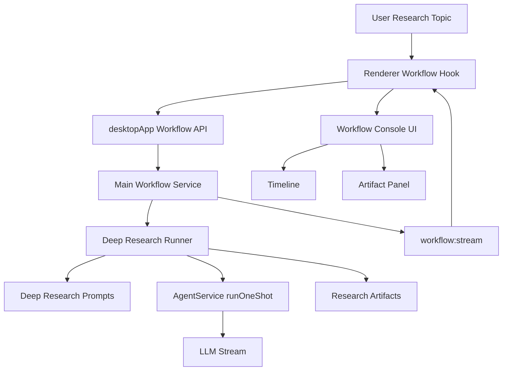
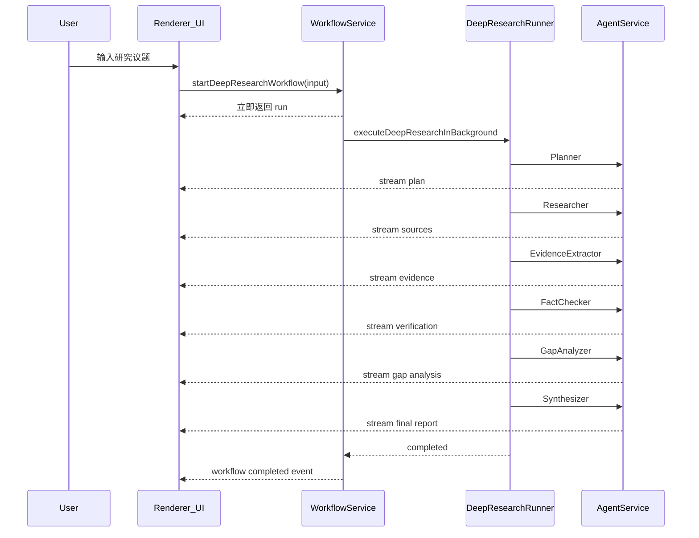

# Deep Research Workflow 第二阶段详细设计

## 1. 目标

第二阶段目标是在现有 `Workflow Runtime` 基础上实现 `deep_research` 工作流，用于围绕用户输入的研究议题进行多阶段资料收集、证据提取、事实核验和报告生成。

核心目标：

- 复用现有 `WorkflowService / WorkflowRun / WorkflowArtifact / WorkflowStreamEvent` 架构。
- 新增 `deep_research` workflow 类型。
- 支持后台运行，不阻塞 IPC 请求。
- 第一小步先实现无工具版骨架，跑通流程、UI 和 artifact。
- 第二小步再为 `Researcher / FactChecker` 增加受控工具调用能力。
- 输出结构化研究产物，而不是只输出聊天文本。

非目标：

- 第一版不做复杂可视化工作流编辑器。
- 第一版不做完整引用格式管理，如 APA/MLA。
- 第一版不做多源自动可信度评分模型，只做结构化字段预留。
- 第一版不要求完全自动化事实核验，允许标记“不确定 / 待验证”。

## 2. 与 Debate Workflow 的关系

当前 `debate workflow` 已经建立了基础抽象：

```text
WorkflowRun
WorkflowStage
WorkflowActor
WorkflowArtifact
WorkflowStreamEvent
WorkflowConsoleView
ArtifactPanel
```

`deep_research` 应复用这些概念。

区别在于：

```text
debate:
- 目标：多观点比较与裁决
- 核心产物：评分、裁决、分歧点
- 关键角色：AgentA / AgentB / Critic / Judge

deep_research:
- 目标：围绕问题收集证据并生成报告
- 核心产物：研究计划、来源列表、证据表、核验报告、最终报告
- 关键角色：Planner / Researcher / EvidenceExtractor / FactChecker / GapAnalyzer / Synthesizer
```

## 3. 总体架构



## 4. 推荐分期

### 4.1 版本 2A：Deep Research 骨架，无工具

目标是先跑通完整 workflow：

```text
plan -> collect -> extract -> verify -> gap -> synthesize -> completed
```

特点：

- 不调用外部工具。
- Researcher 基于模型已有知识生成研究方向、候选来源类型和资料摘要。
- 主要验证 workflow 编排、UI 展示、artifact 结构、后台运行。
- 风险低，不会影响现有工具系统。

### 4.2 版本 2B：Deep Research 工具增强

在 2A 稳定后增加：

- `runOneShot()` 支持 `toolsPolicy`。
- `Researcher` 可调用搜索、网页抓取、本地文件读取等工具。
- `FactChecker` 可调用搜索/抓取工具做二次核验。
- 工具消息挂载 workflow meta，进入 timeline 和 artifact。

## 5. 数据类型设计

扩展 `src/shared/workflow.ts`。

### 5.1 DeepResearchRunInput

```ts
export type DeepResearchDepth = 'quick' | 'standard' | 'deep';

export type DeepResearchSourcePreference = 'web' | 'local' | 'mixed';

export type DeepResearchRunInput = {
  topic: string;
  scope?: string;
  depth?: DeepResearchDepth;
  sourcePreference?: DeepResearchSourcePreference;
  maxSearchRounds?: number;
  constraints?: string;
};
```

### 5.2 ResearchSource

```ts
export type ResearchSourceReliability = 'low' | 'medium' | 'high';

export type ResearchSource = {
  id: string;
  title: string;
  url?: string;
  filePath?: string;
  publisher?: string;
  author?: string;
  publishedAt?: string;
  retrievedAt: number;
  summary: string;
  reliability: ResearchSourceReliability;
  notes?: string;
};
```

### 5.3 EvidenceItem

```ts
export type EvidenceConfidence = 'low' | 'medium' | 'high';

export type EvidenceItem = {
  id: string;
  claim: string;
  evidence: string;
  sourceIds: string[];
  confidence: EvidenceConfidence;
  supports?: string[];
  contradicts?: string[];
  limitations?: string;
};
```

### 5.4 DeepResearchConfig

```ts
export type DeepResearchConfig = {
  topic: string;
  scope?: string;
  depth: DeepResearchDepth;
  sourcePreference: DeepResearchSourcePreference;
  maxSearchRounds: number;
  evidenceRequirement: 'low' | 'medium' | 'high';
  actors: string[];
  stages: string[];
};
```

### 5.5 DeepResearchRunResponse

```ts
export type DeepResearchRunResponse = {
  run: WorkflowRun;
};
```

## 6. Artifact 设计

Deep Research 的核心是 artifact，而不是消息文本。

建议新增 artifact 类型：

```text
research_config
research_plan
source_list
evidence_table
verification_report
gap_analysis
final_report
```

## 7. Stage 设计

建议第二阶段定义这些 stages：

```text
plan
collect
extract
verify
gap
collect_more
synthesize
```

第一版执行：`plan -> collect -> extract -> verify -> gap -> synthesize`。

`collect_more` 作为后续能力预留：当 `gap_analysis.shouldRunAnotherRound === true` 且未超过 `maxSearchRounds` 时执行。

## 8. Actor 设计

- `planner`：拆解研究问题并制定研究计划。
- `researcher`：收集资料和来源。
- `evidence_extractor`：抽取结构化证据。
- `fact_checker`：核验证据可靠性和冲突点。
- `gap_analyzer`：判断证据缺口和追加研究需求。
- `synthesizer`：生成最终研究报告。

## 9. Main 进程实现

新增文件：

```text
src/main/workflows/deep-research-runner.ts
src/main/workflows/deep-research-prompts.ts
```

2B 可选新增：

```text
src/main/workflows/deep-research-tools.ts
```

`deep-research-runner.ts` 的核心函数：

```ts
export async function runDeepResearchWorkflow({
  input,
  run,
  signal,
  onRunUpdated,
  onArtifactCreated,
}: DeepResearchRunnerOptions) {
  // plan
  // collect
  // extract
  // verify
  // gap
  // optional collect_more
  // synthesize
}
```

内部复用与 `debate-runner.ts` 相同的模式：

- `updateStage(run, stageId, status)`
- `updateActor(run, actorId, status)`
- `createMeta(run, stageId, actorId, actorRole, phase, artifactType)`
- `runActor(...)`
- `addArtifact(...)`

后续可以把这些通用 helper 抽到 `src/main/workflows/workflow-runner-utils.ts`。

## 10. WorkflowService 扩展

在 `src/main/workflow-service.ts` 增加：

```ts
startDeepResearch(input: DeepResearchRunInput): Promise<DeepResearchRunResponse>
```

语义与 `startDebate()` 一致：

```text
1. 创建 run
2. 存入 runsById
3. 创建 AbortController
4. emit run_updated
5. 后台启动 executeDeepResearchInBackground(...)
6. 立即返回 { run }
```

## 11. IPC 与 Preload

扩展 `src/shared/contracts.ts`：

```ts
startDeepResearchWorkflow(input: DeepResearchRunInput): Promise<DeepResearchRunResponse>;
```

扩展 `src/preload/index.ts`：

```ts
startDeepResearchWorkflow: (input) =>
  ipcRenderer.invoke('workflow:start-deep-research', input)
```

扩展 `src/main/index.ts`：

```ts
ipcMain.handle('workflow:start-deep-research', async (_event, payload) =>
  workflowService.startDeepResearch(payload)
);
```

## 12. Renderer 状态设计

当前 `use-workflow-session.ts` 已经是通用 workflow hook，但提交行为还偏向 debate。

建议改造为：

```ts
selectedWorkflowType: 'debate' | 'deep_research'
```

新增：

```ts
startWorkflow()
startDebateWorkflow()
startDeepResearchWorkflow()
```

## 13. UI 设计

### 13.1 入口

当前默认模式下有“辩论模式”按钮。

第二阶段建议改为 workflow 菜单：

```text
工作流
- 议题辩论
- 深度研究
```

考虑到后续还有 `simulation / forecast`，入口名称应逐步从“辩论模式”升级为“工作流”。

### 13.2 WorkflowConsoleView 复用

`WorkflowConsoleView` 可以继续复用。

需要增强：

- Header 根据 `activeRun.type` 显示不同标题。
- Overview 根据 actor/stage 自动展示，不硬编码 debate。
- ArtifactPanel 使用 renderer registry。

### 13.3 ArtifactPanel Renderer Registry

建议新增：

```text
src/renderer/features/workflows/artifacts/artifact-renderers.tsx
```

注册：

```ts
const artifactRenderers = {
  debate_config: DebateConfigArtifact,
  scoring_table: TextArtifact,
  final_decision: TextArtifact,
  research_config: JsonArtifact,
  research_plan: JsonArtifact,
  source_list: JsonArtifact,
  evidence_table: JsonArtifact,
  verification_report: JsonArtifact,
  gap_analysis: JsonArtifact,
  final_report: TextArtifact,
};
```

## 14. 工具调用设计 2B

当前 `runOneShot()` 使用：

```ts
tools: []
```

所以 deep research 2A 无法调用工具。

2B 建议引入：

```ts
export type WorkflowToolPolicy = {
  enabled: boolean;
  allowedToolNames: string[];
  requireConfirmation: boolean;
};
```

工具授权建议：

```text
planner: disabled
researcher: web_search / web_fetch / read_file / grep_content
evidence_extractor: disabled
fact_checker: web_search / web_fetch
gap_analyzer: disabled
synthesizer: disabled
```

注意点：

- tool result message 必须挂 `workflowMeta`。
- tool approval UI 需要展示 run/stage/actor。
- tool result 应进入 `WorkflowTimeline`。
- tool data 应能被 runner 收集并转成 `source_list` 或 `evidence_table`。

## 15. Deep Research MVP 流程



## 16. 实施步骤

### 16.1 版本 2A

1. 扩展 `src/shared/workflow.ts`。
2. 新增 `src/main/workflows/deep-research-prompts.ts`。
3. 新增 `src/main/workflows/deep-research-runner.ts`。
4. 扩展 `WorkflowService`。
5. 扩展 IPC / preload / renderer client。
6. 扩展 `use-workflow-session.ts`。
7. 扩展 UI 入口。
8. 扩展 ArtifactPanel。
9. 验证 `npm run typecheck` 和 `npm run build`。

### 16.2 版本 2B

1. 设计 `WorkflowToolPolicy`。
2. 扩展 `runOneShot()` 支持工具。
3. 将 tool result 挂 workflow meta。
4. Researcher 支持受控工具。
5. FactChecker 支持受控工具。
6. Tool approval UI 展示 workflow actor 信息。
7. 将工具结果转为 `source_list` / `evidence_table`。
8. 增加更细的 artifact renderer。

## 17. 风险与取舍

### 17.1 无工具版 Researcher 可信度有限

2A 阶段不会真正检索资料，因此最终报告应明确标记：

```text
当前为无外部工具研究结果，事实性结论需要进一步验证。
```

### 17.2 工具调用权限不能直接复用普通 Agent

Deep Research 应按 actor 授权，避免所有角色都能调用工具。

### 17.3 Artifact 结构化输出可能不稳定

模型输出 JSON 可能失败。

建议第一版容忍文本 artifact：

- 先保存原始文本。
- 后续再引入 JSON repair / schema validation。

### 17.4 长任务取消

Deep Research 会比 debate 更长，必须复用后台运行和 `cancelWorkflow(runId)`。

### 17.5 来源管理复杂度

2B 之前不要承诺严格引用，只做来源字段和证据表预留。

## 18. 推荐验收标准

版本 2A 完成标准：

- 默认模式下能进入 workflow 选择。
- 能选择“深度研究”。
- 输入研究主题后立即返回 run，后台执行。
- UI 能看到 Planner、Researcher、EvidenceExtractor、FactChecker、GapAnalyzer、Synthesizer 输出。
- ArtifactPanel 能看到 research plan、source list、evidence table、verification report、gap analysis、final report。
- 普通聊天和 debate workflow 不受影响。
- `npm run typecheck` 通过。
- `npm run build` 通过。

版本 2B 完成标准：

- Researcher 能按授权调用工具。
- FactChecker 能按授权调用工具。
- Tool result 能在 workflow timeline 中显示。
- Source list 能包含真实 URL 或文件路径。
- Evidence table 能引用 source id。
- 取消 workflow 能中止正在执行的工具/模型请求。
